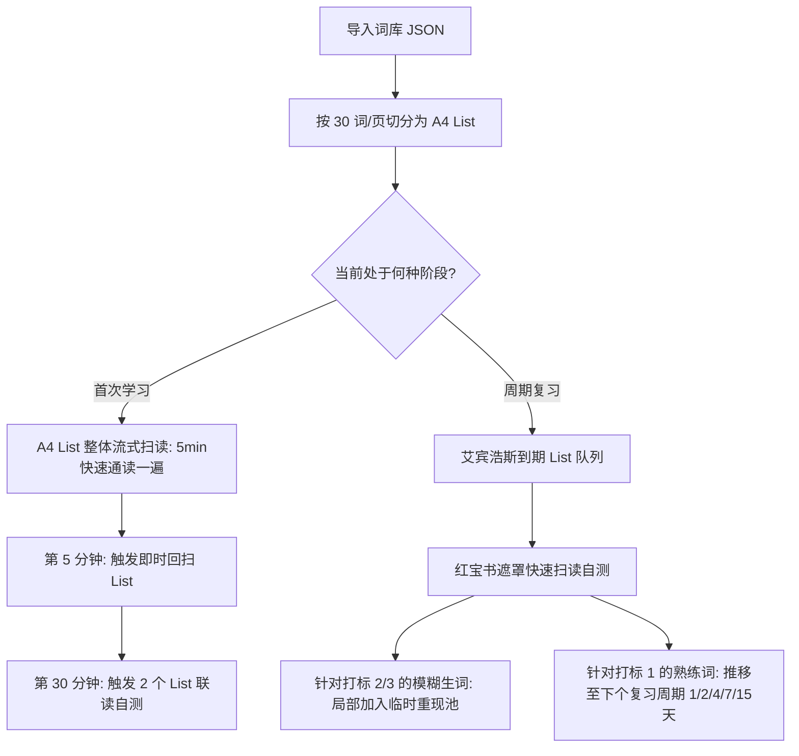

# 技术架构与实现规范 (Technical Specification)

## 1. 技术栈选型

| 维度 | 选型 | 决策依据 |
|---|---|---|
| **构建工具 & 框架** | **Vite + React 19 + TypeScript** | 极速冷启动、强类型保障、现代并发特性支持高频键盘交互 |
| **状态管理** | **Zustand** | 极简、高性能，适合单页高频状态（焦点行、快捷键映射、复习计数器） |
| **持久化存储** | **IndexedDB (Dexie.js)** | 纯客户端离线运行，支持万级词库毫秒级检索、断点恢复与离线复习 |
| **样式与布局** | **Tailwind CSS v4** | 现代设计系统原子化构建，原生支持高精度纸张模拟与自定义排版 |
| **动效库** | **Framer Motion** | 纸张翻页、遮罩擦除、平滑焦点框过渡（`layoutId`）、计数插值 |
| **发音引擎** | **Web Speech API + 音频 CDN 兜底** | 零依赖即时合成，内置英美音标发音缓存 |

---

## 2. 数据结构模型 (Database Schema)

```typescript
// 基于 Dexie.js 定义的核心数据模型
export interface WordItem {
  id: string; // 唯一 UUID
  deckId: string; // 所属词书 ID
  listIndex: number; // 所属 A4 List 单元编号 (如 List 1, List 2)
  word: string;
  phonetic?: string;
  pos?: string; // 词性 (n., v., adj.)
  definition: string; // 中文释义
  examples?: string[];
  tags?: string[];
  
  // 艾宾浩斯复习状态
  reviewState: {
    repetition: number; // 已成功复习次数 (0 表示新词)
    interval: number; // 当前间隔 (以天为单位，初期小数表示分钟)
    easeFactor: number; // 简易度因子 (默认 2.5)
    lastReviewDate: number; // 上次复习时间戳
    nextReviewDate: number; // 下次应复习时间戳
    lapses: number; // 遗忘重置次数
    status: 'new' | 'learning' | 'reviewing' | 'mastered';
  };
}

export interface DeckItem {
  id: string;
  title: string;
  description?: string;
  totalWords: number;
  listSize: number; // 每个 A4 纸张包含的单词数 (默认 30)
  createdAt: number;
  updatedAt: number;
}

export interface ReviewSessionLog {
  id: string;
  deckId: string;
  listIndex: number;
  reviewedCount: number;
  masteredCount: number;
  fuzzyCount: number;
  unknownCount: number;
  durationSeconds: number;
  timestamp: number;
}
```

---

## 3. 核心算法设计：双层艾宾浩斯调度 (Two-Tier Ebbinghaus Engine)

传统 SM-2 仅针对单个独立卡片，而“A4 纸感背单词”引入了 **List 单元流式推进**。



### 遗忘曲线间隔步进公式 (Modified SM-2 for Lists & Words)
1. **即时周期（当天）**：
   - 步长 1：立即学习完毕后 $\Delta t = 5 \text{ min}$
   - 步长 2：$\Delta t = 30 \text{ min}$
   - 步长 3：$\Delta t = 12 \text{ hours}$
2. **长效周期（跨天）**：
   $$I(n) = \begin{cases} 
   1 \text{ 天}, & n = 1 \\ 
   2 \text{ 天}, & n = 2 \\ 
   4 \text{ 天}, & n = 3 \\ 
   7 \text{ 天}, & n = 4 \\ 
   15 \text{ 天}, & n = 5 \\ 
   30 \text{ 天}, & n = 6 
   \end{cases}$$
3. **简易度动态修正**：
   $$\text{EF}' = \text{EF} + (0.1 - (5 - q) \times (0.08 + (5 - q) \times 0.02))$$
   （$q \in [1, 5]$ 为键盘评级：1-陌生，3-模糊，5-秒认）

---

## 4. UI 架构与排版引擎

### 4.1 A4 纸张排版容器（CSS 纯布局规范）
```css
/* 真实 A4 宽高比与纸质阴影容器 */
.a4-paper-container {
  width: 100%;
  max-width: 960px;
  min-height: calc(960px * 1.414);
  background-color: #FAFAF7; /* 温暖纸白 (Light Academia 主色) */
  box-shadow: 0 10px 30px -5px rgba(0, 0, 0, 0.08), 0 0 0 1px rgba(0, 0, 0, 0.04);
  padding: 3rem 3.5rem;
  border-radius: 4px;
}
```

### 4.2 动效系统技术实现
1. **焦点游标 (Morphing Cursor)**：使用 Framer Motion 的 `layoutId="active-row-indicator"`，实现 `J/K` 上下移动时平滑跟随的边框/高亮胶囊。
2. **红宝书遮罩 (Mask Reveal)**：通过 Tailwind 的 `clip-path` 或 `transition-[filter,opacity]` 实现按空格时以 150ms `ease-out` 无重排平滑刮开。
3. **批量加载交错动效 (Stagger Offset)**：单页 30 词初次入场采用 `staggerChildren: 0.02`，自下而上轻微偏移 4px + 淡入，杜绝眩晕感。

---

## 5. 项目工程目录规划
```
words/
├── src/
│   ├── assets/              # 字体与音频资源
│   ├── components/
│   │   ├── common/          # 基础组件 (Button, Dialog, Tooltip)
│   │   ├── paper/           # A4 纸张排版容器与多列列表
│   │   │   ├── A4Container.tsx
│   │   │   ├── WordRow.tsx
│   │   │   ├── MaskOverlay.tsx
│   │   │   └── FocusIndicator.tsx
│   │   ├── dashboard/       # 便当盒控制台 (遗忘曲线日历、统计)
│   │   │   ├── BentoOverview.tsx
│   │   │   ├── ReviewTimeline.tsx
│   │   │   └── DeckCard.tsx
│   │   └── import/          # JSON 导入校验与解析器
│   │       ├── JsonImporter.tsx
│   │       └── SchemaValidator.ts
│   ├── db/                  # Dexie.js 本地持久层
│   │   └── index.ts
│   ├── engine/              # 艾宾浩斯调度算法
│   │   ├── ebbinghaus.ts
│   │   └── scheduler.ts
│   ├── hooks/               # 键盘快捷键监听与发音 Hook
│   │   ├── useHotkeys.ts
│   │   └── useSpeech.ts
│   ├── stores/              # Zustand 状态切片
│   │   ├── useDeckStore.ts
│   │   └── useReviewStore.ts
│   └── types/               # 全局 TypeScript 协议定义
│       └── index.ts
├── docs/                    # 完整产品与开发设计文档
├── package.json
└── vite.config.ts
```
